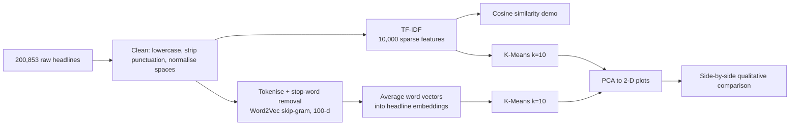

# 📰 News Headline Similarity & Clustering: TF-IDF vs Word2Vec

**Teaching a machine to group 200,853 news headlines by topic, without a single label, and measuring where keyword matching ends and meaning begins.**


---

## 🎯 At a Glance (60-second read)

| | |
|---|---|
| **Business question** | How do search engines, news apps and recommendation systems decide that two pieces of text are "about the same thing"? |
| **Data** | 200,853 HuffPost headlines (Jan 2012 – May 2018) from the News Category Dataset |
| **Approach** | Two competing text representations, **TF-IDF** (keywords) and **Word2Vec** (meaning), each fed into **K-Means (k = 10)** and visualised with **PCA** |
| **Headline result** | Word2Vec produced 10 well-balanced topical groups (5%–16% of data each). TF-IDF produced a few keyword-driven groups, one catch-all bucket and **three single-headline clusters** |
| **Skills demonstrated** | Text preprocessing · Sparse vs dense vector spaces · Cosine similarity · Unsupervised learning · Dimensionality reduction · Critical evaluation of one's own results |

> **Why this matters commercially:** the same pipeline underlies "related articles", duplicate-story detection, newsroom auto-tagging, support-ticket routing and semantic search. This project isolates the core decision behind all of them: *which representation of text do you cluster on?*

---

## 🧭 Pipeline



---

## 🔬 What Was Built

### 1. Text cleaning
Lowercasing, punctuation and special-character removal, whitespace normalisation (`clean_headline`), plus tokenisation with NLTK English stop-word removal for the Word2Vec branch.

### 2. TF-IDF representation
`TfidfVectorizer(stop_words='english', max_features=10000)` → a sparse matrix of shape **(200,853 × 10,000)**.

### 3. Cosine similarity demo
The headline *"What To Watch On Hulu That's New This Week"* was compared against the first ten headlines:

| Compared with | Cosine similarity |
|---|---|
| *"What To Watch On Amazon Prime That's New This Week"* | **0.538** |
| *"Donald Trump Is Lovin' New McDonald's Jingle…"* | 0.069 |
| *"Jim Carrey Blasts 'Castrato' Adam Schiff…"* | 0.053 |
| *"There Were 2 Mass Shootings In Texas…"* | 0.123 |
| Itself | 1.000 |

The near-duplicate template headline scores far above every unrelated headline, which is exactly the behaviour a "related content" feature relies on.

### 4. Word2Vec representation
Skip-gram Word2Vec trained from scratch on the corpus (`vector_size=100`, `window=5`, `min_count=2`). Each headline becomes the **mean of its word vectors** → a dense matrix of shape **(200,853 × 100)**, which is 100× narrower than the TF-IDF matrix.

### 5. K-Means (k = 10) on both representations
Same algorithm, same `k`, same seed. Only the representation changes, which makes the comparison fair.

---

## 📊 Results

### TF-IDF + K-Means: clusters follow *words*, not *topics*

| Cluster | What the top-5 sample shows |
|---|---|
| 0 | Headlines containing the phrase **"a lot"** across unrelated topics |
| 2 | Headlines containing **"break"** (*break up*, *break the deal*, *break silence*) |
| 3 | Headlines containing **"world"** (*World Cup*, *World Leaders*, *the world rejoices*) |
| 8 | Headlines containing **"crisis"** (housing, education, opioid, "crisis actor") |
| 4 / 6 | Genuinely topical: Trump-centred politics / NAFTA trade talks |
| 9 | A broad **catch-all** of mostly entertainment and general news |
| 1, 5, 7 | **One headline each**, i.e. outlier clusters |


*TF-IDF vectors form narrow, elongated "spokes" in PCA space. The geometry of sparse keyword data, not distinct topics.*

### Word2Vec + K-Means: clusters follow *meaning*

| Cluster | Size | Share | Indicative theme (from top-5 samples) |
|---|---|---|---|
| 6 | 32,112 | 16.0% | Pop-culture, humour and social-media trends |
| 5 | 27,593 | 13.7% | Culture, opinion and society |
| 8 | 26,621 | 13.3% | Politics and social policy |
| 3 | 26,247 | 13.1% | Entertainment and celebrity news |
| 7 | 19,896 | 9.9% | US politics (Trump-centred) |
| 9 | 15,701 | 7.8% | Family, travel and how-to lifestyle |
| 4 | 15,349 | 7.6% | Health, mental health and healthcare |
| 2 | 14,792 | 7.4% | Crime, shootings and violence |
| 1 | 12,627 | 6.3% | Celebrity family, babies and photos |
| 0 | 9,915 | 4.9% | Weekly round-ups, "what to watch", listicles |


*The embedding space is dense and continuous. Clusters sit next to one another and overlap at the edges, as expected when topics blend (a celebrity can also be a political story).*

### Takeaway
For meaning-based grouping, the dense Word2Vec space gave more balanced and more thematically coherent clusters than TF-IDF on this corpus. TF-IDF remains the right tool when exact keyword overlap is the goal (for example duplicate or template detection, as the 0.538 score shows).

---

## 🔍 Honest Audit: Limitations, Corrections and Next Fixes

This repository documents its weaknesses on purpose. A result you can trust is worth more than a result that only looks good.

| # | Finding | Impact | Fix |
|---|---|---|---|
| 1 | **Metric correction:** the notebook's commentary quotes the Hulu ↔ Amazon Prime similarity as **0.408**, but the cell output is **0.5377**. | Written claim contradicted the actual output | Corrected in this README; update the notebook's markdown cell |
| 2 | **No quantitative cluster metrics.** The "Word2Vec is superior" conclusion rests on eyeballing 5 headlines per cluster and PCA plots. No silhouette score, inertia/elbow curve or Davies-Bouldin index. | Conclusion is plausible but unproven | Add silhouette and inertia for both models; choose `k` empirically |
| 3 | **Ground truth discarded.** Cell 6 keeps only `headline`, dropping the dataset's `category` column. | Prevents ARI / NMI / purity scoring against real labels, the strongest possible test | Keep `category`, compute ARI and NMI for TF-IDF vs Word2Vec |
| 4 | **Arbitrary `k = 10`** for both models. | Singleton clusters in TF-IDF suggest `k` or the features are poorly matched | Elbow and silhouette sweep; try `MiniBatchKMeans` |
| 5 | **Contradictory narrative on TF-IDF:** one markdown cell says TF-IDF clusters are "more separated", a later one says they are "harder to separate". | Confusing story for a reader | Replace with one consistent, metric-backed statement |
| 6 | **TF-IDF PCA plot is hard to read:** it uses the default colormap (no `cmap`), so only two to three colours are distinguishable among ten clusters, while the Word2Vec plot uses `tab10`. | Plots are not visually comparable | Use the same colormap, add a legend, sample randomly |
| 7 | **PCA sample is not random.** `X_tfidf[:50000]` takes the first 50,000 rows, but the file is ordered newest-first (first row 2018-05-26, last 2012-01-28). | Plot shows only the most recent slice of the data | `df.sample(...)` with a fixed seed |
| 8 | **Memory-heavy densification:** `X_tfidf[:50000].toarray()` builds a 50,000 × 10,000 float64 matrix (about 4 GB). | Crashes on small machines | Use `TruncatedSVD`, which works on sparse input directly |
| 9 | **Reproducibility gaps.** `Word2Vec` has no `seed` and uses `workers=4`, so embeddings (and therefore clusters) can differ between runs even though K-Means sets `random_state=42`. | Results not exactly repeatable | Set `seed` and `workers=1` for deterministic runs |
| 10 | **Preprocessing side-effects.** Apostrophes are stripped before tokenising (`thats`, `mcdonalds`, `hed`), and stop-word removal drops negations such as *not* and *no*. | Minor noise; negation matters for sentiment tasks | Handle contractions first; keep negations |
| 11 | **Environment coupling.** Data is loaded from a hard-coded Google Drive path and `google.colab.drive`. The dataset is not in the repo. | Others cannot run it as-is | Parameterise the path (see Quick Start) |
| 12 | **Code hygiene.** `KMeans`, `PCA` and `matplotlib` are imported twice, `import os` is unused, `pca` is re-assigned, the Word2Vec object is simply called `model`, and a duplicate `embedding` column of arrays is stored in the DataFrame alongside `X_w2v`. | Harmless but untidy | Consolidate imports; rename to `w2v_model`; drop the column |

---

## 🚀 Quick Start

```bash
# 1. Clone
git clone https://github.com/vishnusai2005/<your-repo-name>.git
cd <your-repo-name>

# 2. Install
pip install pandas numpy scikit-learn matplotlib nltk gensim jupyter

# 3. Get the data (Kaggle: "News Category Dataset", file News_Category_Dataset_v2.json)
#    Place it next to the notebook.

# 4. Run
jupyter notebook similarity_clustering.ipynb
```

In the notebook, replace the Google Drive block with a local path:

```python
df = pd.read_json("News_Category_Dataset_v2.json", lines=True)
```

---

## 🗺️ Roadmap

- [ ] Silhouette, Davies-Bouldin and elbow analysis for `k`
- [ ] ARI / NMI against the 'category' labels
- [ ] TF-IDF-weighted averaging of word vectors
- [ ] Sentence-BERT embeddings as a third contender
- [ ] Top-terms-per-cluster tables and automatic cluster naming
- [ ] "Find similar headlines" semantic-search demo (nearest neighbours)
- [ ] Interactive UMAP visualisation

---

## 💼 Where This Applies

- **Media and publishing:** automatic topic tagging, related-article widgets, duplicate-story detection
- **E-commerce and support:** grouping tickets, reviews or product queries
- **Search and recommendation:** retrieval and "more like this" features
- **Market and brand intelligence:** discovering themes in large volumes of unlabelled text

---

## 🛠️ Tech Stack

`Python` · `pandas` · `NumPy` · `NLTK` · `scikit-learn` (TfidfVectorizer, KMeans, PCA, cosine_similarity) · `Gensim` (Word2Vec) · `Matplotlib` · `Google Colab`

---

## 👤 Author

**Vishnusai Vydhyam**: final-year B.Tech, Computer Science Engineering (AI & ML), Mohan Babu University, Tirupati. Seeking ML, Data Science and AI Engineer fresher and intern roles.

[GitHub](https://github.com/vishnusai2005) · [LinkedIn](https://www.linkedin.com/in/vishnusai-vydhyam) · [Hugging Face](https://huggingface.co/v2005) · [X](https://x.com/VishnusaiSaii)

---

*Dataset: News Category Dataset (HuffPost headlines, 2012–2018), publicly available on Kaggle. This project is for learning and portfolio purposes.*
